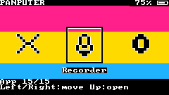
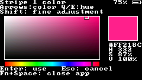

# POS — Pan Operating System

POS is an ESP-IDF/FreeRTOS operating environment for Panputer, the M5Stack
Cardputer ADV. Resident firmware provides the core and recovery machinery;
ordinary FAT32 microSD files hold the system resources and user data.

**0.5.4-dev fixes the guided installer's interrupted USB backup handling. It
retries failed fast reads using smaller ROM transfers, keeps progress readable,
and still requires two matching full-capacity reads before any firmware write.**
The official signed update feed, arrow navigation and existing apps are included.
Both firmware roles and native tests are checked; physical POS installation and
recovery validation is still outstanding.

## Download and install

[Easy installation with pos-setup](docs/EASY_INSTALL.md) · [GitHub Releases](https://github.com/thatsockmonke/POS/releases) · [Download the complete package](docs/DOWNLOADS.md) · [Full installation guide](docs/INSTALL.md) · [Feature status / remaining roadmap](docs/STATUS.md)

The complete master roadmap is not implemented. On-device maps/navigation,
and Meshtastic compatibility remain. Wireless firmware deployment is evidence-gated
until physical USB recovery and OTA/rollback tests pass on your device/build.
Games, a POS terminal, installable apps/package management and automatic power
management have been removed from scope. The battery indicator replaces that
power-management milestone. See the current [remaining list](docs/STATUS.md#remaining-software-roadmap-current-priorities).

**Beginner route:** download **pos-setup** from the release, put it in your Linux
home folder (ChromeOS: Files → Linux files), then run:

```sh
chmod +x ~/pos-setup
~/pos-setup
```

Choose **Install POS**. The wizard handles downloads, hashes, device detection,
FAT32 preparation, private backups and the USB flash/readback steps. Erasing a
card and flashing each require explicit confirmation. Crostini can copy to a
shared FAT32 card; raw formatting and USB forwarding depend on ChromeOS access.
Read [the easy guide](docs/EASY_INSTALL.md) for those limits and the final on-device
INSTALL/power-cycle steps. No ESP-IDF or compiler is needed for prebuilt releases.

For the prebuilt bundle, you need Python/esptool on your Linux computer, a FAT32
microSD and a USB data cable. Back up/prove factory recovery; copy the extracted
`pos-install/` folder onto SD; flash `pos-installer-usb.bin` at **0x0**; boot the
installer and type **INSTALL**; power-cycle when prompted and complete setup.
The installer flashes the final runtime for you. Keep the SD in Panputer.
Follow the full guide for exact commands, checks, USB permissions and recovery.


Implemented:

- A single pink → yellow → blue sequence at boot (180 ms per color), then yellow slides into the middle
  over blue. Pink slides into the top when yellow is halfway across. Large centered
  **POS** lettering fades in across all three stripes, holds for one second, then normal boot continues.
- Native ST7789 display output and TCA8418 ADV keyboard input, with USB fallback.
- A fifteen-app horizontal launcher with black icons outlined in white, streamed from SD.
  Left/Right moves the ribbon; Up or Enter opens the centered app. Only one foreground app runs.
- Background app: 1-12 horizontal stripes, visual arrow-key color picker, Q/E hue,
  Shift fine adjustments, launcher preview and explicit Save & Apply.
  Backgrounds survive restarts, settings changes and verified backup/restore.
- Central input routing, protected Home shortcut, and a separate input supervisor.
- One foreground application with initialize/foreground/event/update/render/save/
  exit callbacks and resource release. Counter demonstrates a persistent app;
  Settings, Diagnostics, Files, Music, Share, Location, Radio, Range Test,
  Recovery and About also use the app manager.
- First-time name/device/timezone/brightness setup, plus optional Wi-Fi.
  Connect for a session or save up to four networks in a passphrase-encrypted NVS vault.
  Passwords remain masked and are never written to SD.
- Text Editor: New/Open/Recover, SD-backed editing beyond available RAM, protected
  streamed saves, 32-level undo/redo, selection, SD clipboard, word/page/line
  navigation, Find, Go to line and an unsaved-changes prompt. Ctrl+S saves;
  Fn+arrows move the cursor; WASD types ordinary letters.
- Shared Wi-Fi services: scan/manual/saved connections, status, SNTP time sync,
  certificate-validated HTTPS downloads and GET/POST API requests. Responses stream
  to Downloads. A temporary, session-key-protected LAN web page transfers files.
- Files: paginated browsing, previews/editor/music opening, new folders, rename,
  copy/cut/paste, verified streamed folder copies, Trash/restore and explicit
  permanent deletion. Existing targets and protected system paths are refused.
- Music: SD-streamed MP3 and 16-bit PCM WAV, library/folder browsing, pause,
  previous/next, volume, shuffle and plain-text M3U playlists.
- Share: one interface for local save, temporary Wi-Fi transfer and authenticated
  BLE transfer. Nearby POS peers compare pairing numbers, then accept/reject a
  file offer; chunks resume from the receiver offset and SHA-256 verifies completion.
- GPS/Location: checksummed NMEA, latitude/longitude, fix age, altitude, speed,
  satellites, HDOP and UTC from the official cap's UART.
- Radio: Semtech SX1262 driver on the shared SD SPI bus, IDs, duplicate suppression,
  unicast ACK/retry, verified persistent outbox and readable received-message logs.
  Compatible POS peers use the same frequency/settings; this is not Meshtastic.
- Radio Range Test: GPS/RSSI/SNR and packet-ID/counter CSV logs, receive-only or
  timed unicast probes. Unknown coordinates and unavailable signal values stay blank.
- Settings > Expansion hardware shows cap/GPS detection, fix, feature enablement
  and transmit permission. Radio/Range require a detected, enabled cap. Maps has a
  GPS-presence gate; the Maps app itself is still future work. Location sharing
  requires explicit consent. Transmit consent resets after reboot.
- Always-visible black battery box: percentage left of a changing icon, smoothing,
  hysteresis, unknown state and a sustained-voltage near-full indication. This is
  an estimate, not a hardware charger-status measurement.
- Settings with direct brightness/date/time controls, regional/custom timezones,
  preferences-only reset, crash reports and safe-mode requests.
- Signed HTTPS Software Update with explicit public-key trust, compatibility and
  sequence checks, streamed assets/firmware, preserved previous System and OTA
  rollback recovery. The [official feed and signing key](docs/UPDATES.md) are built in;
  custom sources remain available.
- Persistent readable SD crash reports, a retained RTC panic snapshot and NVS boot
  failure policy. Safe mode requires explicit normal-boot selection; online OTA
  waits for a healthy 60-second UI interval before confirmation.
- Redundant, checksummed settings; formal system/user boundaries and standard folders.
- On-device installer confirmation, verification/progress/cancellation, factory
  recovery and separate OTA runtime slots. Files and flash are read back before boot selection.
- Repair from the exact original package; verified ZIP/folder backups and journaled reinstall.
  The old tree stays in `POS.previous`; the backup is never deleted automatically.
- Streamed ZIP/folder restore, conflict preservation under `POS/Recovered`, and
  shared settings validation/migration with JSONL recovery reports. Unknown preferences stay accessible.
- Diagnostics for heap, firmware size, boot/frame timing, battery voltage, keyboard
  positions, input drops, main-stack headroom, frame min/mean/max and a measured 1 MiB SD write/read integrity test.
  Device/SD measurements are saved as JSON; Wi-Fi and app-cycle samples can be compared by build and boot session.
- Linux USB probe, double-read factory backup and identity/hash-checked factory
  restore tools, private serial capture, hardware evidence reports, native backup/restore and a launcher renderer.
- Paginated notices and file browsing with folder page counts, fixed Previous/Next controls
  and an explicit empty-folder state; owned partial folder backups can resume.
- Ctrl+U clears text fields; character counters show limits and passwords stay masked.
  Setup checks each name before moving on and preserves saved settings when cancelled.

Software-rendered launcher and color picker:




Software-rendered boot animation (loops here; plays once on the device):


[Final splash frame](downloads/0.5.4-dev/boot-splash.png)

The USB bootstrap is unsigned development firmware; online updates require a
trusted P-256 signature. This does not enable secure boot or eFuse anti-rollback. Physical display orientation, all key
positions, SD performance, battery calibration, USB recovery and power-cut safety
still require [hardware validation](docs/HARDWARE_VALIDATION.md).

## Build and test

Use ESP-IDF **v5.5.5**, commit `b774170ff46c393eeb5e495ea37936038d3f4f4f`.
On the prepared cloud machine:

```sh
cd /workspace/POS
. /workspace/pos-cloud/activate.sh
python tools/posctl.py build --build-root build-v050
python -m unittest discover -s tests -v
python tools/posctl.py bundle --build-root build-v050 --output dist/pos-0.5.4-dev --zip-output dist/pos-0.5.4-dev.zip
python tools/posctl.py preview --output dist/launcher.png
python tools/posctl.py preview --screen picker --output dist/color-picker.png
python tools/posctl.py preview --screen boot --output dist/boot-splash.png
python tools/posctl.py preview --screen boot --animate --output dist/boot-animation.png
```

On Linux Framework/Crostini, follow Espressif's
[Linux setup](https://github.com/espressif/esp-idf/blob/v5.5.5/docs/en/get-started/linux-macos-setup.rst),
clone the pinned SDK and submodules, run `./install.sh esp32s3`, and source
`export.sh`. GCC and OpenSSL development headers are needed for native services
(Debian/Ubuntu: `build-essential libssl-dev`); ESP-IDF provides Python/esptool,
CMake, Ninja and cJSON. All third-party code used by POS is in the SDK or the
vendored public-domain font; no Arduino board framework is required. MP3 and radio drivers are vendored at
pinned commits; their licenses are included in the source and installation bundle.

Builds use four Ninja jobs and separate ignored `build/installer` and
`build/runtime` directories and sdkconfigs. When upgrading generated 0.1 configs,
set main task stack to 16384 and FAT filesystem locks to 32, or preserve the old
configs and use a fresh `--build-root` so the new defaults apply. Version 0.3.7
also enables the full TLS certificate bundle; existing generated configs must
enable it or be replaced using a fresh build root. Pass that same build root to
`bundle` so installer and runtime come from the matching build. Version 0.3.8
requires fresh NimBLE/Secure Connections defaults too; the commands above use a
separate build-v050 root rather than reusing an old generated sdkconfig.

`bundle`, `package`, preview and backup commands refuse existing output names.
A bundle contains the merged `pos-installer-usb.bin`, `pos-install.zip`, an
expanded `card/pos-install` tree, `INSTALL.md` and `SHA256SUMS`. Do not flash the
standalone runtime at the factory address. Read [INSTALL.md](docs/INSTALL.md).

## Controls

On the Cardputer ADV, hold **Fn** and press the printed arrow keys:
**;** = Up, **,** = Left, **.** = Down, **/** = Right. WASD type ordinary letters.
USB terminals can use their normal arrow keys.

| Context | Keys |
| --- | --- |
| Launcher | Left/Right arrows move; Up or Enter opens the centered app |
| Menus | Up/Down arrows move; Enter selects |
| Color picker | Arrow keys move color cursor; Q/E changes hue; Shift makes finer steps; Enter accepts |
| Text fields | WASD are ordinary letters; Shift, Backspace, Enter; Ctrl+U clears |
| Music | Space pauses; Left/Right previous/next; Up/Down volume; R shuffle; P add to playlist |
| Text Editor | Type normally; Fn+arrows move; Ctrl+S saves; Ctrl+F finds; Ctrl+G goes to line; Esc opens menu |
| Back/cancel | Fn+backtick (Escape); closes an app from its main screen |
| Close app / launcher | Fn+Space or a short G0 button press, from any screen; editor asks about unsaved text; unsaved background edits are discarded |
| Recover from a stalled app | Hold Fn+Space or G0 for two seconds; restart into recovery |
| USB fallback | ANSI arrow keys, Enter, Escape, and byte 0x1d for Home; IDF monitor itself reserves Ctrl-] |

See the [new apps and expansion hardware guide](docs/APPS.md),
[signed update guide](docs/UPDATES.md), [transfer/radio formats](docs/PROTOCOLS.md) and the [editor and Wi-Fi guide](docs/INSTALL.md#text-editor) for draft recovery,
encrypted network profiles, HTTPS and local transfer controls.

Name validation runs when Enter accepts a field: display names use 1–48 printable
ASCII characters; device names use 1–24 letters, digits or hyphens. Invalid input
returns to the same field, and cancelling before save preserves existing settings.
File browsing shows `Folder page N/M`; Previous and Next stay at the top and show
first/last boundaries. A separate `Menu N/M` appears if the current list spans
more than one screen.

Home propagates through nested dialogs and cancels active file operations safely.
Built-in apps are trusted C callbacks, not a sandbox for hostile native code.
Sleep stops the display/Wi-Fi and requests deep sleep with G0 wake; use the physical
power switch for a true power-off. Peripheral sleep/wake behavior is unverified.

## Storage and recovery

- `/POS/System`: immutable bundled files, installed manifest, boot marker and
  standard Apps/Assets/Fonts/Sounds/Config directories.
- `/POS/Users/Owner`: documents, saves and diagnostics. Owner is a stable profile
  directory; changing the display name does not rename your files.
- `/POS/Users/settings.0.json` and `.1.json`: generation/checksum-based settings slots.
- `/Downloads`, `/Music`, `/POS/Maps`: ordinary user data. Legacy user folders are preserved.
- `/POS/Users/Owner/Trash`, `/Radio`, `/RangeTests`: user-owned recovery, messaging
  and CSV data (the latter two paths are beneath the same Owner directory).
- `/POS/Temp`, `/POS/Cache`, `/POS/Updates` and `/.POS-Recovery-Temp`: disposable system work.
- `/POS.installing`: owned staging transaction; `/POS.previous`: retained previous system.
- `/POS-Filesystem-Backup.zip` or `/POS-Filesystem-Backup/`: verified user backup.
- `/Diagnostics`: device and SD measurement JSON; `/pos-reinstall.pos`: reinstall journal.

Other SD files are treated as user data. Backup excludes only the documented
system/staging/cache/installer/backup/transaction paths. Restore never blindly
writes old System files over the new runtime. Conflicts and unsupported preferences
remain under `POS/Recovered`, and the original ZIP remains available.

Small collections use a standard stored ZIP (up to 2048 files, below 2 GiB).
Larger collections, files above the ZIP seek limit, or empty directories automatically
use a plain folder backup with an inventory and per-file SHA-256. Folder backups
stream files through FAT32's individual-file limit of **4 GiB minus one byte**,
have no 2048-file or total 2 GiB cap, and preserve empty directories. Paths are
still limited to 240 bytes and 16 directory levels. Aggregate sizes use 64-bit
counters. No POS program is needed to read `files/` on a normal computer.

Both forms require enough free space for another copy plus conservative FAT and
metadata overhead; a mostly full card cannot hold its own full backup. They do
not erase data to make room. See [recovery](docs/RECOVERY.md) for resuming a folder
backup, migration reports and limitations, and [evidence collection](docs/VALIDATION.md)
for the actual-device workflow.

See [format and transaction details](docs/FORMAT.md),
[recovery semantics](docs/RECOVERY.md), [hardware profile](docs/HARDWARE.md) and
[third-party notices](THIRD_PARTY.md). The card is never formatted or automatically
wiped. On-device maps/navigation and Meshtastic compatibility remain later milestones.
Recorder, Files Audio Player, IR/IMU, versioned save migrations and evidence-gated
deployment are described in [APPS.md](docs/APPS.md), [MIGRATIONS.md](docs/MIGRATIONS.md)
and [DEVELOPMENT.md](docs/DEVELOPMENT.md).


Recorder is a launcher app: Start recording, Space to pause/resume, Enter/Esc to
stop and save, Fn+Space to save and close. Standard WAV files live in `/Recordings`.
Files → select MP3/WAV → **Play in Audio Player** opens a transient player; it
is absent from the launcher and stops at EOF. The Music library app is retained.
Settings → **IR & motion** provides live BMI270 readings and explicit NEC sends.
See [Developer tooling](docs/DEVELOPMENT.md) for `posctl flash`, `files` and gated
`deploy`. HTTPS uses ESP-IDF's common-root certificate bundle to preserve the
existing OTA layout; validation remains enabled and unsupported roots are rejected.
